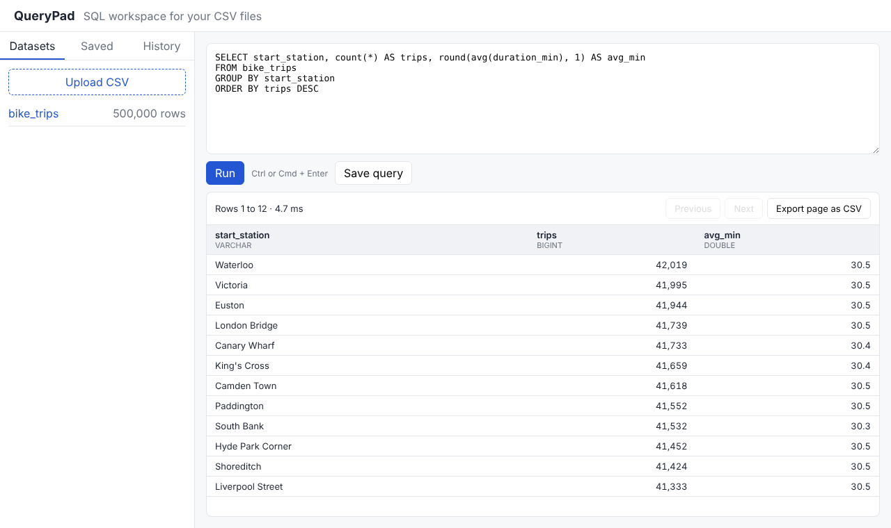

# QueryPad

A small SQL workspace for CSV files. Upload a CSV, explore its schema, run read only SQL against it in the browser, page through the results, and keep saved queries and a run history.



**Stack:** React + TypeScript (Vite) · Python FastAPI · DuckDB (query engine) · SQLite (metadata) · pytest · Vitest · Locust · Docker · GitHub Actions

## Features

* **CSV upload** with schema inference; each file becomes a DuckDB table.
* **SQL editor** (Ctrl or Cmd + Enter to run) with a results grid showing column types, paging and CSV export.
* **Saved queries** and a **run history** with status, duration and row count for every run.
* **Read only by design** (see Safety below).

## Architecture

```
React (Vite)  ──HTTP/JSON──▶  FastAPI
                               ├── QueryEngine   DuckDB, guard, paging, timeout, LRU cache
                               └── MetadataStore SQLite: saved_queries, query_runs
```

* `backend/app/guard.py` uses DuckDB's own parser to split the input into statements and only allows a single `SELECT`. Comments or string literals cannot hide a second statement (`SELECT 1; DROP TABLE x` is rejected).
* `backend/app/engine.py` wraps the query as `SELECT * FROM (<query>) LIMIT n+1 OFFSET k`. Fetching one extra row tells the UI whether a next page exists without paying for a separate `COUNT(*)`.
* **Timeouts:** every query runs on its own cursor with a timer that calls `interrupt()`, so a runaway query is cancelled (HTTP 408) and the engine stays usable.
* **Caching:** `backend/app/cache.py` is an O(1) LRU cache (OrderedDict) keyed by `(dataset version, query, limit, offset)`. Uploading or dropping a dataset bumps the version, so stale results are never served.
* **Concurrency:** blocking DuckDB calls run in FastAPI's thread pool, so the event loop stays free while queries execute.

## Safety

* Only single `SELECT` statements are accepted; `INSERT`, `DROP`, `COPY`, `ATTACH`, `SET` and friends are rejected before they reach the database.
* The query database is opened with `enable_external_access = false`, so a `SELECT` cannot read server files through `read_csv('/etc/passwd')` and similar functions. Uploads are parsed by a separate, short lived connection and copied across.
* Dataset names are checked against a strict identifier pattern; uploads are capped at 50 MB; page size is capped at 1,000 rows.

## Performance

Measured on a 2 vCPU Linux VM, single uvicorn worker, 500,000 row synthetic dataset, Locust running on the same machine:

| Scenario | Result |
|---|---|
| Load test: 50 concurrent users, 45 s, mixed dashboard and ad hoc aggregations | 6,864 requests, **0 failures**, ~152 req/s, p50 11 ms, **p95 35 ms** |
| Group by aggregation over 500k rows, cold | 12 to 16 ms |
| Same query served from the LRU cache | ~0.15 ms |
| Cache hit rate during the load test | 59% |

Reproduce with `loadtest/locustfile.py` (instructions below). Numbers will differ on other hardware.

## Running locally

**Docker**

```bash
docker compose up --build
# open http://localhost:8000 (seeded with a 500k row bike_trips dataset)
```

**Without Docker**

```bash
# backend
cd backend
python -m venv .venv && source .venv/bin/activate
pip install -r requirements.txt -r requirements-dev.txt
python scripts/make_sample_data.py 500000 data/bike_trips.csv
QUERYPAD_SEED_CSV=data/bike_trips.csv uvicorn app.main:app --reload

# frontend (second terminal)
cd frontend
npm install
npm run dev   # http://localhost:5173, proxies /api to :8000
```

## Tests

```bash
cd backend && pytest -q          # 38 tests: guard, engine, cache, API
cd frontend && npm test          # 10 tests: formatting, CSV export, results grid
```

**Load test** (with the backend running and seeded):

```bash
locust -f loadtest/locustfile.py --host http://localhost:8000 --headless -u 50 -r 10 -t 60s
```

CI (GitHub Actions) runs the backend tests, frontend type check, tests and build, then builds the Docker image.

## Ideas for next steps

* Query plans: show `EXPLAIN` output next to results.
* Parquet upload alongside CSV.
* Per user workspaces with authentication.
* Charts for two column results.
